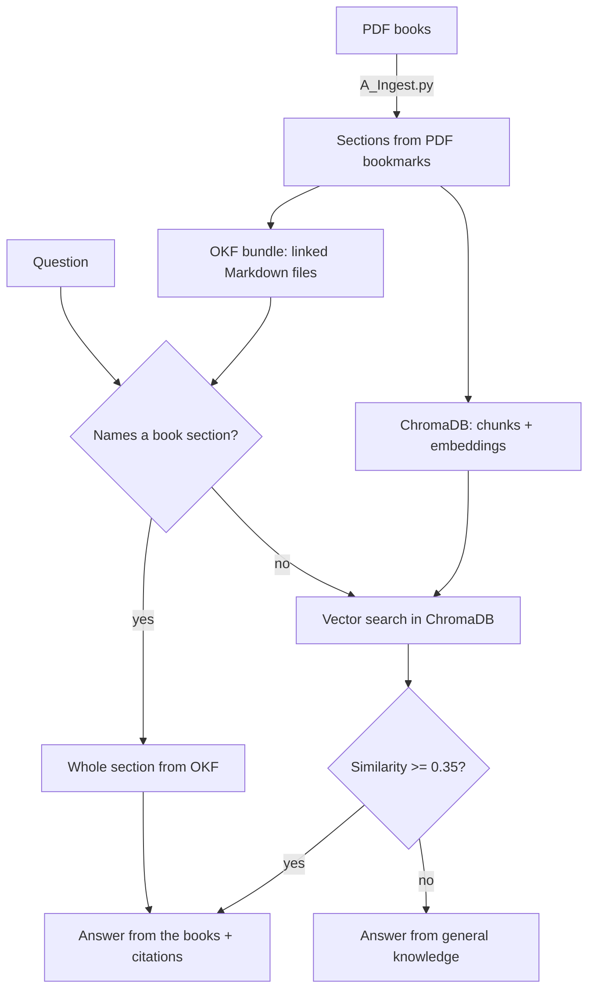

# AI Concepts Explainer

An AI tutor that explains machine learning, deep learning, NLP and LLM concepts at
three levels (beginner, intermediate, advanced). Every answer is grounded in three
textbooks and shows the book and page it came from.

<!--  -->

**Tech:** Python, LangGraph, RAG, OKF (Open Knowledge Format), ChromaDB,
Sentence-Transformers, Groq (Llama 3.3 70B), FastAPI, SQLAlchemy, HTML/JavaScript

## Features

- **Two-level retrieval.** If the question names a book section ("What is LSTM?"), the
  whole section is read from the OKF knowledge bundle. Otherwise ChromaDB finds the
  closest chunks by meaning.
- **Agent with routing.** A LangGraph graph answers from the books when the match is
  good enough, and from general knowledge when it is not.
- **Page-level citations**, e.g. `NLP-LLM, p. 45 (2.5.2 Long-Short Term Memory, LSTM)`.
- **Structured answers**: summary, explanation, formula (LaTeX), analogy, worked example,
  common mistake and follow-up questions.
- **Three explanation levels** and **conversation memory** for follow-ups like "give an example".
- **Free to run**: Groq's free API tier and a local embedding model.

## How it works



| File | What it does |
|---|---|
| `A_Ingest.py` | Reads the PDFs, splits them into chapters and sections using the bookmarks, writes the OKF bundle and fills ChromaDB |
| `B_rag.py` | Settings, OKF exact lookup and vector search |
| `C_tool.py` | Groq LLM, prompts for each level and the answer format |
| `D_agents_v3.py` | LangGraph agent: search, route, answer |
| `E_database.py` | Saves conversations and messages (SQLite) |
| `main.py` | FastAPI server |
| `index.html` | Chat interface |
| `test_agent.py` | Asks the 40 questions in `questions.json` and saves the answers |

## Books

| Short name | Book |
|---|---|
| MML | *Mathematics for Machine Learning*, Deisenroth, Faisal and Ong ([free online](https://mml-book.github.io/)) |
| UDL | *Understanding Deep Learning*, Simon J. D. Prince ([free online](https://udlbook.github.io/udlbook/)) |
| NLP-LLM | *Natural Language Processing and Large Language Models* |

The PDFs are not included in this repository because of copyright. Download them and
put them in the `pdfs/` folder. To use other books, add them to `BOOK_NAMES` in `B_rag.py`.

## Run it locally

Needs Python 3.12 or newer.

```bash
git clone https://github.com/YOUR-USERNAME/ai-concepts-explainer.git
cd ai-concepts-explainer

python -m venv venv
venv\Scripts\activate                 # Mac/Linux: source venv/bin/activate
pip install -r requirements.txt
```

1. Get a free API key at https://console.groq.com/keys
2. Copy `.env.example` to `.env` and paste your key into it
3. Create a `pdfs` folder and put the books in it
4. Build the knowledge base (takes a few minutes the first time):
   ```bash
   python A_Ingest.py
   ```
5. Start the server and open http://127.0.0.1:8000
   ```bash
   uvicorn main:app --reload
   ```

## API

| Method | Endpoint | What it does |
|---|---|---|
| POST | `/conversation/new` | Starts a conversation, returns `conversation_id` |
| POST | `/chat` | `{conversation_id, question, level}` returns a structured answer |
| GET | `/conversation/{id}` | All messages of a conversation |
| GET | `/health` | Number of OKF sections and vector chunks |

## Testing

With the server running:

```bash
python test_agent.py
```

It asks 40 questions (basic, intermediate, advanced, calculations, typos, off-topic,
prompt injection) and saves the answers to `answers.json` and `answers.csv`.

## Design decisions

- **Why two kinds of retrieval?** An exact section match gives the complete, correct
  section with no guessing. Vector search covers every other question.
- **Why PDF bookmarks?** They give clean chapter and section boundaries, so citations
  point to the right section and page.
- **Why a similarity threshold?** For topics the books don't cover, weak matches would
  only confuse the LLM, so the agent switches to general knowledge.
- **Why structured output?** A fixed answer format (a Pydantic model) makes every answer
  consistent and easy to display.
- **Why a cache?** The Groq free tier is rate-limited, so repeated questions are answered
  without a new API call.

## Future work

- Stream answers token by token
- Deploy online with a live demo
- Measure answer quality automatically on the test questions
